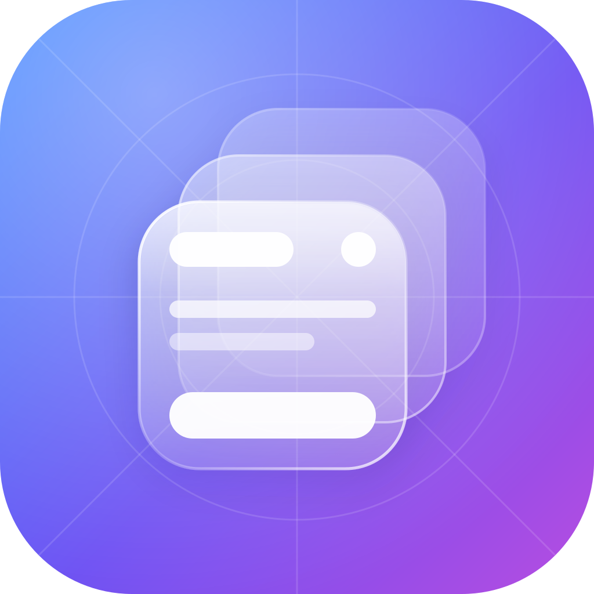

<div align="center">



# apple-hig-skills

**Teach your coding agent to build native Apple apps that feel like Apple made them.**

Agent skills for SwiftUI, UIKit and AppKit, based on the current
[Human Interface Guidelines](https://developer.apple.com/design/human-interface-guidelines/):
Liquid Glass, iOS 27, macOS 27, visionOS, watchOS, tvOS and iPhone Duo.

[](LICENSE)
[](https://agentskills.io)
[](https://developer.apple.com/design/whats-new/)
[](#whats-inside)

Works with **Claude Code · OpenAI Codex · Gemini CLI · Cursor · GitHub Copilot · OpenCode · Windsurf**<br>
and any other agent that reads [Agent Skills](https://agentskills.io).

</div>

---

## Why

Coding agents already know the HIG basics. In our tests, the gaps were elsewhere:

- **They build what the brief says, even when it fights the platform.** Asked for an in-app Light/Dark
  theme picker, both Opus and Haiku built one without a word. The HIG advises against it.
- **They quote "the HIG" from memory.** They gave no links and didn't know the 2025–2026 changes:
  search as a tab, sheet button rules, toolbar overflow in iOS 27, iPhone Duo.
- **They hand-roll what the system already provides.** Custom headers replaced navigation bars,
  glass was drawn by hand, and colors were hard-coded.

With these skills, the same agents link every decision to the guideline it rests on, raise brief
conflicts before building, and use the system components.

<table>
<tr><th>Without skills</th><th>With skills</th></tr>
<tr><td>

```swift
Button { tool = t } label: {
    Image(systemName: t.icon)
        .frame(width: 44, height: 44)
}
.glassEffect(tool == t
    ? .regular.tint(.blue).interactive()
    : .regular.interactive(),
    in: .circle)
```

Hand-made glass and a hard-coded blue.

</td><td>

```swift
Button(t.title, systemImage: t.icon) {
    tool = t
}
.labelStyle(.iconOnly)
.buttonBorderShape(.circle)
.buttonStyle(.glass(t == tool
    ? .regular.tint(.accentColor)
    : .regular))
```

System glass button style, app accent color, and a real label for VoiceOver.

</td></tr>
</table>

> **Brief conflicts (read first)**
>
> Nobody could be asked, so I built what was requested and flagged the conflicts here.
>
> 1. **In-app theme picker (Appearance).** The HIG advises against app-specific appearance
>    settings. People expect the systemwide choice to apply, and the app looks broken when it
>    ignores it. ([Dark Mode, Best practices](https://developer.apple.com/design/human-interface-guidelines/dark-mode#Best-practices))
>    Compliant alternative: delete the Appearance section and the root `.preferredColorScheme`
>    line, and follow the system appearance.
>
> <sub>Excerpt from the reply of Claude Haiku with these skills, building a settings screen.</sub>

| Test case ([evals](evals/)) | Without skills | With skills |
|---|---|---|
| Settings screen with a theme-picker requirement | builds it silently | flags the conflict, links the rule |
| Port an iPhone app to macOS | no undo, no search | sidebar, Settings scene, menu commands, undo, search |
| Review a flawed screen | unranked list, no sources | Blocker / Major / Minor, 12 HIG links |
| Adopt Liquid Glass | `glassEffect` by hand, `.tint(.blue)` | `.buttonStyle(.glass)`, accent tint |

## Quick start

```sh
npx skills add InvalidPandaa/apple-hig-skills
```

The [skills CLI](https://skills.sh) detects your agents and installs the skills for each one. Select
all skills: the others rely on `apple-hig`, which holds the lookup tool.

Then just ask:

```text
Design the onboarding for my iPad journaling app.
Review SettingsView.swift against the HIG.
Make this toolbar Liquid Glass compliant.
What does the HIG say about badges on tab bars?
```

## Install for your agent

<details>
<summary><b>Claude Code</b>: plugin with skills and a reviewer subagent</summary>

```text
/plugin marketplace add InvalidPandaa/apple-hig-skills
/plugin install apple-hig@apple-hig-skills
```

Skills load automatically when a task matches. You can also call them directly:
`/apple-hig:hig-design`, `/apple-hig:hig-review`, `/apple-hig:hig-lookup`. The plugin also adds a
read-only `hig-reviewer` subagent for independent reviews.
</details>

<details>
<summary><b>OpenAI Codex</b></summary>

Codex reads skills from `~/.agents/skills/` (personal) and `.agents/skills/` (per repository).
Install with `npx skills add InvalidPandaa/apple-hig-skills` or [manually](#manual-install). Call a
skill explicitly with `$hig-design`, or pick one from `/skills`.
</details>

<details>
<summary><b>Gemini CLI</b></summary>

```sh
gemini extensions install https://github.com/InvalidPandaa/apple-hig-skills
```

Gemini also reads `~/.agents/skills/`, so a [manual install](#manual-install) works too. Skills
activate when a task matches; Gemini asks for consent the first time.
</details>

<details>
<summary><b>Cursor</b></summary>

Cursor reads skills from `.cursor/skills/` in a project and from `~/.cursor/skills/` for all
projects. Install with `npx skills add InvalidPandaa/apple-hig-skills`, or symlink the folders from
`skills/` there.
</details>

<details>
<summary><b>GitHub Copilot</b> (CLI, VS Code agent mode, cloud agent)</summary>

Copilot reads skills from `.github/skills/` in a repository and from `~/.copilot/skills/` for
personal use. Install with `npx skills add InvalidPandaa/apple-hig-skills`, or symlink the folders
from `skills/` there.
</details>

<details>
<summary><b>OpenCode, Windsurf, Cline and others</b></summary>

`npx skills add InvalidPandaa/apple-hig-skills` knows the skills folder of each supported agent.

If your agent has no skills support, point its instructions file (`AGENTS.md`, `GEMINI.md`, rules)
at the entry skill:

```markdown
For any UI work on Apple platforms, read and follow
~/.apple-hig-skills/skills/apple-hig/SKILL.md and the sibling skills it refers to.
```
</details>

### Manual install

```sh
git clone https://github.com/InvalidPandaa/apple-hig-skills.git ~/.apple-hig-skills
mkdir -p ~/.agents/skills
ln -s ~/.apple-hig-skills/skills/* ~/.agents/skills/
```

Swap `~/.agents/skills` for your agent's folder if it uses a different one. Update later with
`git -C ~/.apple-hig-skills pull`. Keep all skills side by side: they call
`../apple-hig/scripts/hig.py`.

## What's inside

| Skill | Use it for |
|---|---|
| **`apple-hig`** | Entry point. Design workflow, the 2026 design principles, common brief conflicts, live lookup |
| `hig-design` | A design spec (structure, components, states, accessibility, sources) before any code |
| `hig-review` | Audits of code, screenshots or PRs: severity-ranked findings, each with rule, link and fix |
| `hig-lookup` | "What does the HIG say about …?", answered from the live pages |
| `hig-platforms` | iPhone, iPad, Mac, Watch, TV, Vision Pro, iPhone Duo, games: idioms, inputs, porting checklists |
| `hig-components` | Choosing and configuring system components, with the SwiftUI API for each |
| `hig-liquid-glass` | The Liquid Glass design language, its verified APIs, and migrating iOS 17/18-style screens |
| `hig-foundations` | Color, typography, layout, SF Symbols, app icons, Dark Mode, motion, writing, branding |
| `hig-patterns` | Onboarding, permissions, loading, feedback, undo, search, settings, modality, AI features |
| `hig-accessibility` | VoiceOver, Dynamic Type, contrast, motion, Assistive Access, inclusion, right-to-left |

Each skill is a short `SKILL.md` with decision tables, rules, brief conflicts and common mistakes.
The detail lives in `references/`, which the agent reads only when needed.

## Staying current

Apple changes the HIG every June and several times in between. Three things keep the skills in step:

1. **Updates through releases.** The knowledge lives in the skills, as original summaries with links.
   When Apple changes a page, the skills get updated and you pick it up with `npx skills update`,
   `claude plugin update apple-hig@apple-hig-skills` or `git pull`.
2. **A weekly check.** A [GitHub Action](.github/workflows/hig-updates.yml) compares every HIG page with
   the state the skills were written against (Change log date and content hash in
   `skills/apple-hig/index.json`). When something changed, it opens an issue listing the changed pages,
   what their Change log says and which skill files link them.
3. **A safety net in between.** When an agent fetches a page that changed after the last sync, the
   lookup tool puts a note on top, so the agent follows the live page rather than an outdated summary.

The lookup tool is also how agents check exact rules, recent changes and topics without a summary
(CarPlay, HealthKit, Apple Pay and others):

```sh
python3 skills/apple-hig/scripts/hig.py search "search field"
python3 skills/apple-hig/scripts/hig.py fetch sheets --section "Best practices"
python3 skills/apple-hig/scripts/hig.py fetch tab-bars --section "Change log"
python3 skills/apple-hig/scripts/hig.py fetch "/documentation/swiftui/view/glasseffect(_:in:)"
```

It needs Python 3 (standard library only) and network access to developer.apple.com. Without
Python, agents read the HIG pages directly.

## Development

```sh
python3 -I skills/apple-hig/scripts/hig.py selftest   # renderer self-test, offline
python3 -I scripts/validate.py                        # frontmatter, links, slugs, sizes, manifests
python3 -I scripts/validate.py --online               # + HIG anchors, API links, copied-text check
claude plugin validate .                              # Claude plugin manifest
claude plugin eval . --allow-tools "Bash(python3:*)" WebFetch   # with/without comparison
```

**Updating after Apple changes the HIG** (the weekly issue tells you when):

```sh
python3 -I scripts/check_updates.py          # changed/new/removed pages and the skill files that link them
# update those skill files in your own words, then:
python3 -I scripts/validate.py --online
python3 skills/apple-hig/scripts/hig.py index  # record the new state as synced
```

Then bump the version in `.claude-plugin/plugin.json` and `gemini-extension.json` (the validator
checks that they match) and commit. The HIG's [What's new](https://developer.apple.com/design/whats-new/)
page gives a summary of each round of changes.

Contributions are welcome. Write rules in your own words, link the HIG section each rule comes from,
and verify every API introduced in OS 26 or later against Apple's documentation.

## License

MIT for the original text and code in this repository. This is an independent project, not
affiliated with or endorsed by Apple Inc. Apple's guidelines are only linked and fetched live,
never redistributed. See [NOTICE.md](NOTICE.md).
